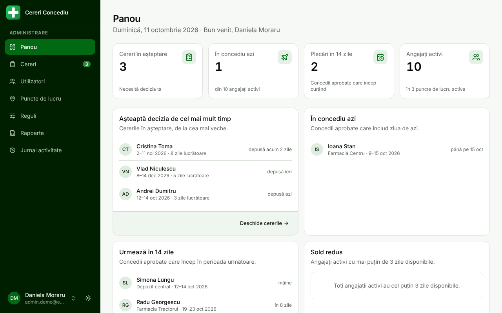
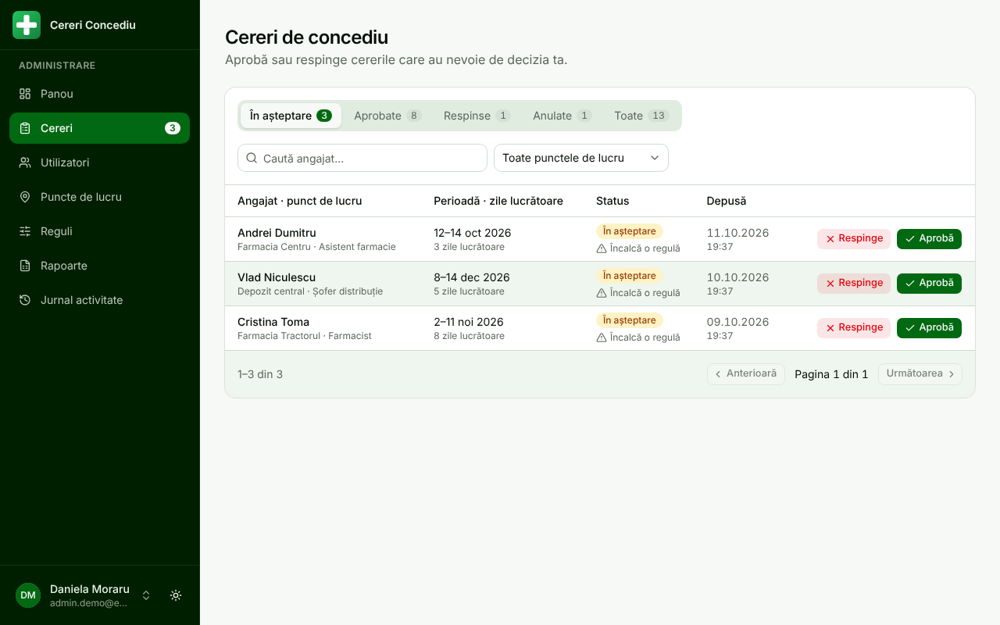
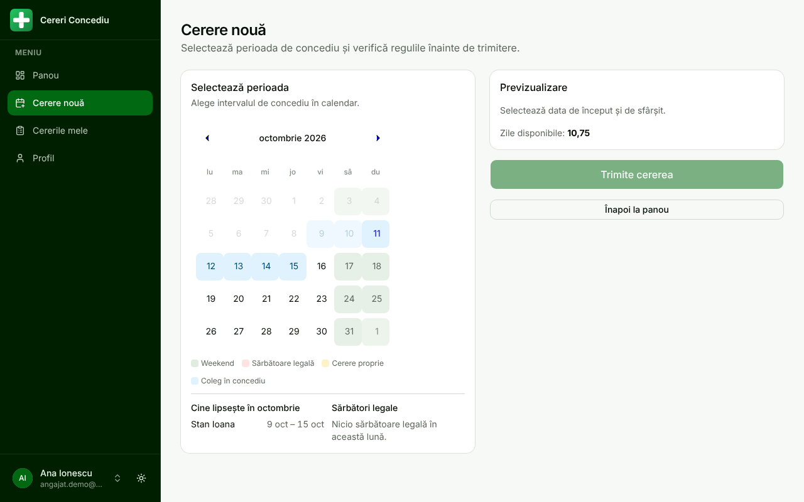
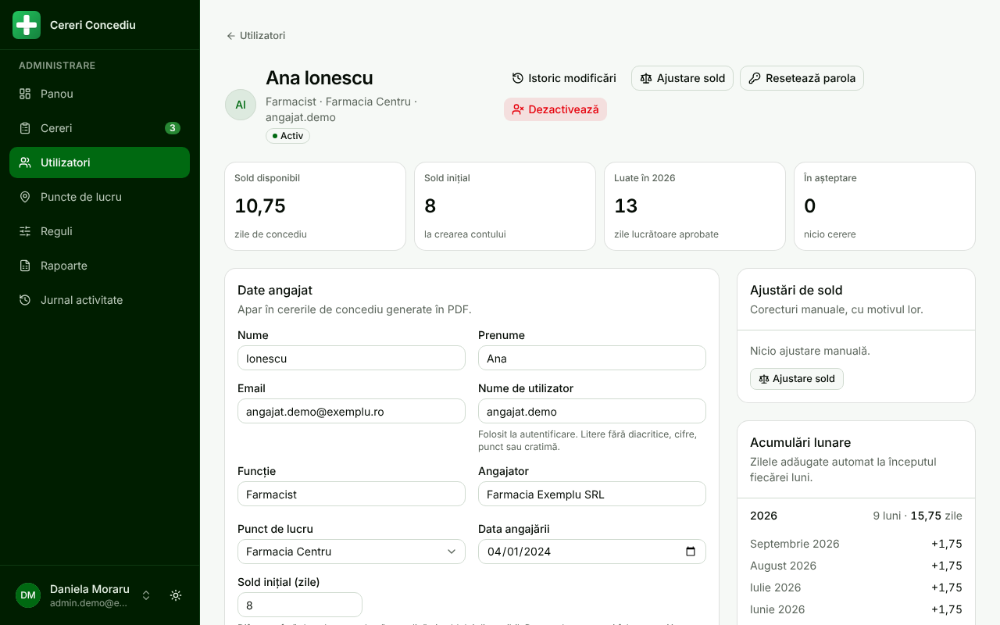
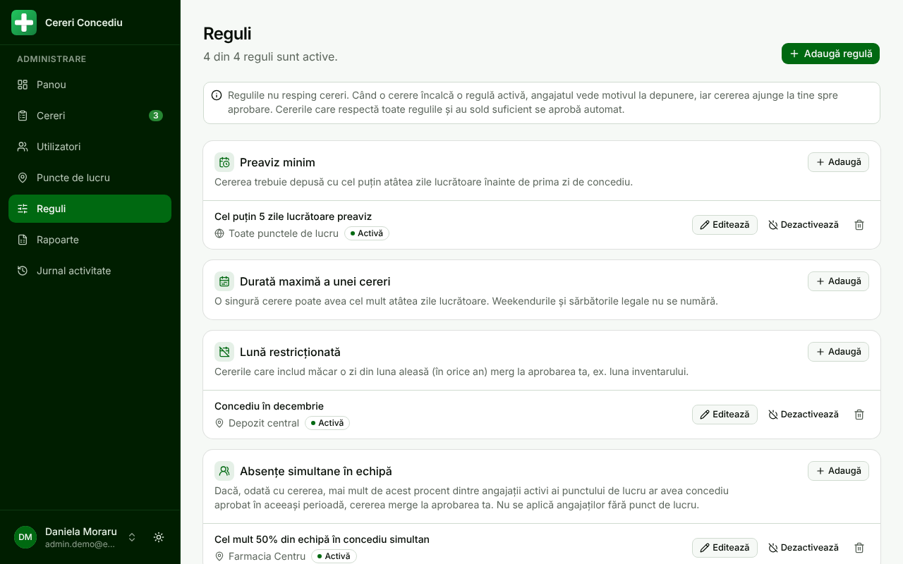
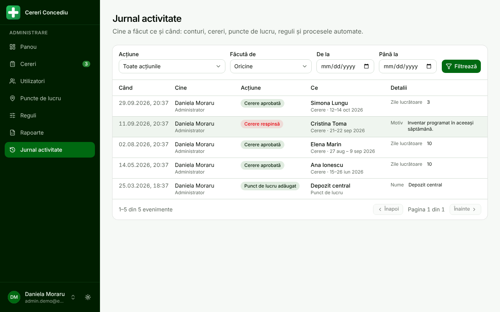
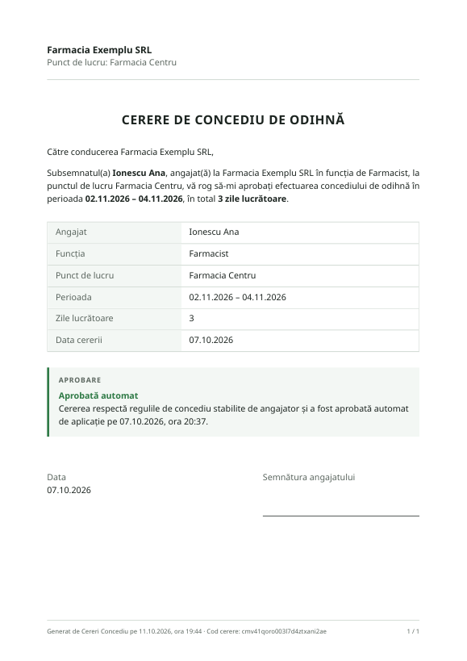
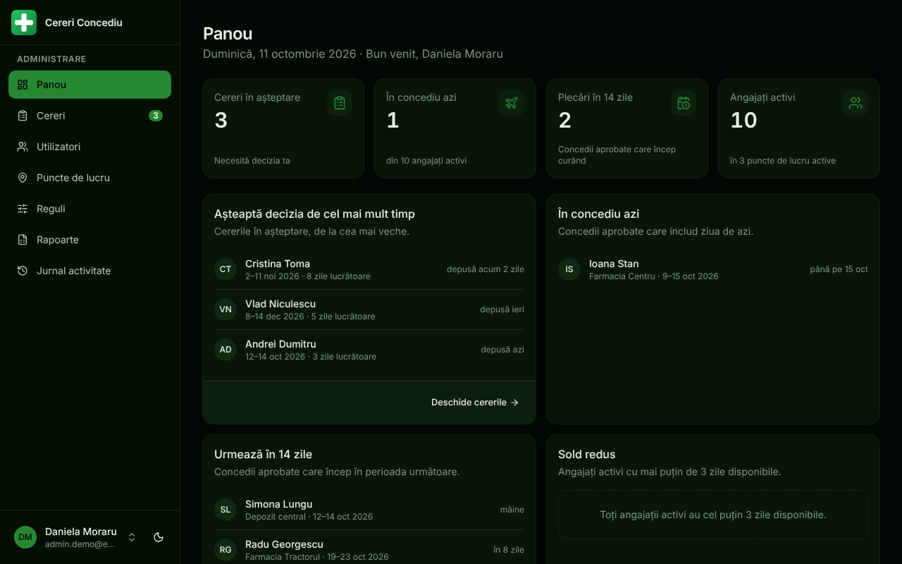
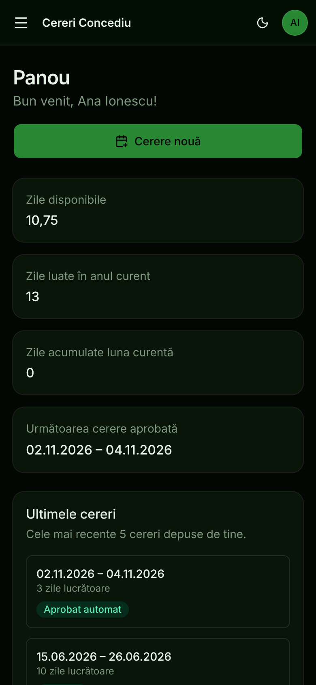

# Cereri Concediu

[](https://github.com/RedOctober7/cereri-concediu/actions/workflows/ci.yml)

Aplicație web pentru cererile de concediu de odihnă într-o firmă cu mai multe puncte de lucru (de exemplu, un lanț de farmacii). Angajații își depun cererile online și văd cine din echipă lipsește. Cererile care respectă regulile firmei se aprobă automat, iar restul ajung la administrator. Zilele se acumulează și expiră după regulile din Codul muncii, iar fiecare cerere aprobată are un PDF gata de semnat.

> **In English:** a leave-management web app for a Romanian company with several locations. Employees request leave online, a rules engine auto-approves compliant requests and routes the rest to an admin, leave balances accrue monthly and expire per the Romanian Labour Code, and every approved request gets a signable PDF. Built with Next.js 16, TypeScript, Prisma/PostgreSQL and NextAuth, with ~280 unit tests run in two time zones and CI.



## Ce poate face

**Angajatul**
- Depune o cerere dintr-un calendar care marchează weekendurile, sărbătorile legale și colegii de la același punct de lucru aflați în concediu.
- Vede înainte de trimitere câte zile lucrătoare are cererea, soldul rămas și dacă cererea se aprobă automat sau merge la administrator, cu motivul.
- Își urmărește cererile, le poate anula pe cele aflate încă în așteptare și descarcă PDF-ul cererilor aprobate.
- Își resetează singur parola prin email.

**Administratorul**
- Panou cu ce cere atenție: cereri în așteptare, cine e în concediu azi, plecări în următoarele 14 zile, angajați cu sold mic.
- Aprobă sau respinge cereri, cu motiv, filtrate după status, punct de lucru și angajat.
- Gestionează angajații: date, sold inițial, ajustări de sold cu motiv, resetare de parolă, dezactivare.
- Configurează reguli fără cod: preaviz minim, durată maximă, lună restricționată (ex. inventar), procent maxim din echipă absent simultan, concediu neîntrerupt anual de minim 10 zile (art. 148).
- Exportă situația zilelor în Excel și vede jurnalul complet al acțiunilor.

**Automat**
- Acumulare lunară de zile (cron Vercel).
- Expirarea zilelor neefectuate după 18 luni (art. 146 alin. 2), pe principiul primul intrat, primul ieșit (FIFO), cu recuperarea anilor ratați.
- Emailuri pentru cereri noi (către administratori), aprobări și respingeri.

| | |
|---|---|
|  |  |
|  |  |
|  |  |
|  |  |

## Decizii tehnice

- **Zilele calendaristice sunt `Date` la miezul nopții UTC** (`lib/dates.ts`), exact ce scrie Prisma într-o coloană `@db.Date`. Browserul trimite `yyyy-MM-dd`, iar „azi” se calculează în ora României. Așa rezultatele sunt aceleași pe serverul Vercel (UTC) și pe un laptop din București; testele rulează în ambele fusuri orare.
- **Sărbătorile legale din România se calculează, nu se scriu de mână**: Paștele ortodox (algoritmul Gauss), Rusaliile, plus 6–7 ianuarie începând cu 2024 (Legea 37/2024).
- **Regulile nu resping, ci direcționează**: o cerere care încalcă o regulă ajunge la administrator cu motivul explicit. Doar suprapunerea cu o cerere proprie, o dată în trecut sau lipsa zilelor lucrătoare blochează trimiterea. Previzualizarea și crearea folosesc aceeași funcție de validare.
- **Operațiile pe sold sunt atomice**: crearea, aprobarea și ajustarea blochează rândul angajatului (`SELECT … FOR UPDATE`), iar tranzițiile de status sunt condiționate de statusul curent, ca un dublu click să nu scadă zilele de două ori. Cron-urile sunt idempotente.
- **Securitate**:
  - rolul și starea contului se reîncarcă periodic din baza de date, deci un cont dezactivat își pierde accesul în câteva minute;
  - rate limiting la login pe utilizator + IP, cu Upstash Redis;
  - tokenurile de resetare se stochează doar ca hash, sunt de unică folosință și expiră într-o oră; răspunsul e același pentru orice utilizator, ca să nu se poată afla ce conturi există;
  - hash-urile parolelor sunt excluse global din interogările Prisma;
  - callbackUrl acceptă doar căi de pe același site.
- **Serviciile externe sunt opționale**: fără chei Resend sau Supabase, aplicația face build și rulează, iar emailurile sunt doar sărite. PDF-urile se generează la cerere, cu fontul Noto Sans inclus, pentru diacritice corecte.

## Stack

Next.js 16 (App Router), React 19, TypeScript, Tailwind CSS 4 + shadcn/ui (Base UI), Prisma 6 + PostgreSQL (Supabase), NextAuth.js, Resend + React Email, @react-pdf/renderer, ExcelJS, Vitest, GitHub Actions, Vercel (inclusiv cron-urile).

## Structură

```
app/(employee)     paginile angajatului: panou, cerere nouă, cereri, profil
app/(admin)/admin  administrare: panou, cereri, utilizatori, puncte de lucru, reguli, rapoarte, jurnal
app/(auth)         login, schimbare și resetare parolă
app/api            rutele API (cereri, administrare, resetare parolă, cron)
lib/constraints    motorul de reguli (validateLeaveRequest)
lib/leaves         acumulare, expirare (rollover) și statistici
lib/dates.ts       convenția pentru zile calendaristice
lib/holidays.ts    sărbătorile legale și zilele lucrătoare
lib/pdf, lib/emails  documentul cererii și emailurile
prisma/            schema, migrările și scripturile (seed, demo, reparații)
tests/             testele Vitest
```

## Rulare locală

Ai nevoie de Node.js 20.19+ și de o bază PostgreSQL (locală sau Supabase).

```bash
npm install
cp .env.example .env.local      # completează DATABASE_URL, DIRECT_URL, NEXTAUTH_SECRET
npx prisma migrate deploy
npm run db:seed                 # creează administratorul din ADMIN_USERNAME / ADMIN_PASSWORD
npm run dev
```

Pentru date de test realiste, pe o bază separată:

```bash
DEMO_MODE=true NEXT_PUBLIC_DEMO_MODE=true npm run db:seed-demo   # ȘTERGE baza
```

Scriptul creează 3 puncte de lucru, 10 angajați și cereri în toate stările. Cu `NEXT_PUBLIC_DEMO_MODE=true`, pagina de login afișează butoanele „Intră ca administrator” și „Intră ca angajat” (`admin.demo` / `angajat.demo`, parola `Demo2026!`). În modul demo, conturile demo nu pot fi dezactivate și parola lor nu poate fi schimbată.

| Comandă | Ce face |
|---|---|
| `npm run dev` | server de dezvoltare |
| `npm test` | testele Vitest, în UTC și în ora României |
| `npm run lint` | ESLint |
| `npm run build` | build de producție |
| `npm run db:seed-demo` | date demo (doar cu `DEMO_MODE=true`) |
| `npm run db:reset-password -- <utilizator> <parolă>` | resetează parola unui cont |
| `npm run db:fix-leave-dates -- --before=<ISO>` | repară cererile vechi salvate cu o zi mai devreme (fără `--apply` doar afișează) |

## Deploy

Pe Vercel, cu PostgreSQL pe Supabase:

1. Setează în Vercel variabilele din `.env.example`. Obligatorii: `DATABASE_URL` (pooler, port 6543, `?pgbouncer=true`), `DIRECT_URL` (port 5432), `NEXTAUTH_SECRET`, `NEXTAUTH_URL` și `CRON_SECRET` (minim 16 caractere). Opționale: `RESEND_API_KEY` și `EMAIL_FROM` pentru emailuri, Supabase Storage pentru arhivarea PDF-urilor, Upstash Redis pentru rate limiting comun.
2. Rulează migrările pe baza de producție: `npx prisma migrate deploy`.
3. Cron-urile din `vercel.json` rulează acumularea lunară (pe 1 ale lunii) și expirarea anuală (pe 1 iulie).

O instanță demo publică are nevoie de un proiect Vercel separat, cu propria bază de date, `DEMO_MODE=true` și `NEXT_PUBLIC_DEMO_MODE=true`.

CI-ul (`.github/workflows/ci.yml`) rulează la fiecare push lint-ul, verificarea de tipuri, testele în ambele fusuri orare și build-ul. Separat, aplică migrările pe un Postgres 16 și verifică dacă schema s-a îndepărtat de migrări.
